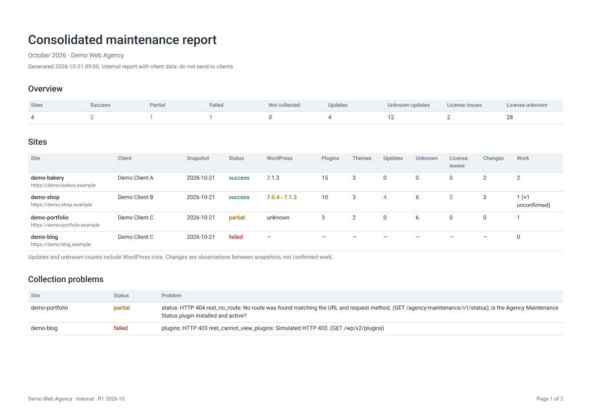
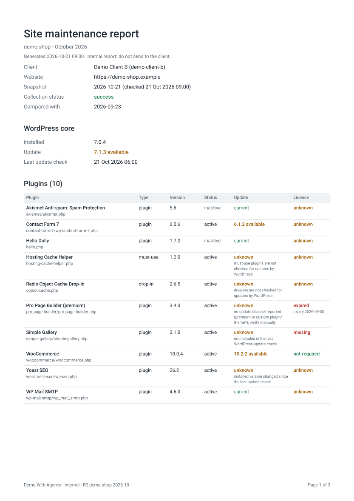
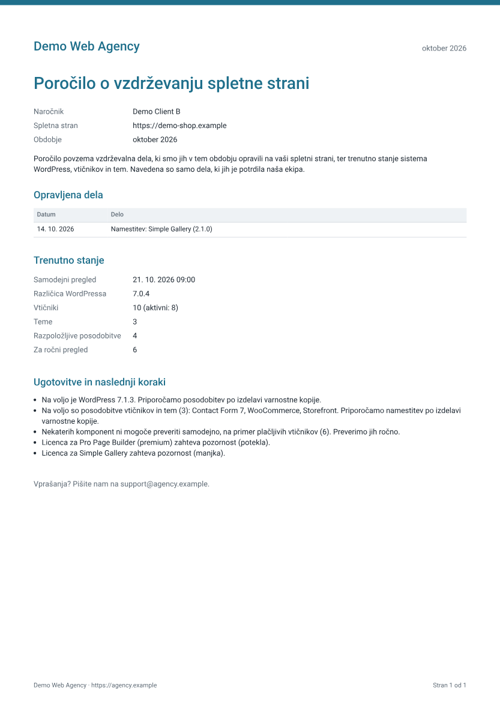

# 02 · Reports R1, R2 and R3

All pictures and samples here come from the demo sites (`yarn demo`). They contain no real client data.

```powershell
yarn report                      # month of the newest snapshot
yarn report --period 2026-10     # a chosen month
```

## Files

```
reports/2026-10/
├── r1-consolidated-2026-10.pdf          R1: all sites (internal)
├── r1-inventory-2026-10.csv             R1: every plugin and theme of every site (internal)
├── r2-internal-<siteId>-2026-10.pdf     R2: one per site (internal)
├── r3-client-<siteId>-2026-10.pdf       R3: one per site, for the client
└── _report.json                         short summary for the Claude skill
```

Running the report again replaces the files. If an old file was not replaced (for example a site was removed), you get a `NOTE`. Don't send that file.

## Which data a report uses

- **Current state:** the newest snapshot inside the month. If that check failed, the report says so.
- **Changes:** compared with the last good snapshot before the month.
- **No snapshot in the month:** the site is shown as `not-collected`, never as OK.
- **Licenses:** a `valid` license whose `expiry_date` has passed is shown as `expired`.
- **Work:** only confirmed rows of `maintenance_log.csv` with a date inside the month.

## R1: all sites (PDF + CSV)



The **PDF** has an overview, one row per site, collection problems, pending updates on all sites and license problems.

The **CSV** has one row for every item on every site, also items without updates. A failed site still gets one row with the reason. Sample: [samples/r1-inventory.sample.csv](../samples/r1-inventory.sample.csv).

In Excel you can filter by plugin name (`name`), update state (`update_available`: `true`, `false`, `unknown`) or license (`license_status`).

- The CSV opens in Excel with č, š and ž shown correctly.
- Values that start with `=`, `+`, `-` or `@` get a `'` in front, so a plugin name can't run as an Excel formula.
- If Excel puts everything in one column, set `"csvDelimiter": ";"` in `agency.json`.

## R2: one site, internal (PDF)



R2 shows:

1. the site, the check date and the collection status
2. collection problems, if any
3. WordPress version and update
4. **all** plugins and **all** themes, with update and license state
5. the license register for the site, with "did you mean…?" hints for typos
6. changes since the last snapshot (marked as observations, not work)
7. confirmed work, with internal notes
8. unconfirmed work, marked as "not in the client report"

## R3: client report (PDF, Slovenian or English)



The logo, colour, language and contact come from `agency.json`.

R3 shows:

1. agency, client, website and month
2. **Work performed:** only confirmed work, for example "Posodobitev: Elementor (3.31.0 › 3.32.1)"
3. **Current status:** check date, WordPress version, plugins, themes, updates
4. **Issues and next steps:** updates, items that need a manual check, license problems. "No open issues" is shown only when nothing is unknown.

R3 **never** shows passwords, internal notes, error messages, unconfirmed work, detected changes or other clients. Tests check this.

A person reads every R3 before it is sent.
